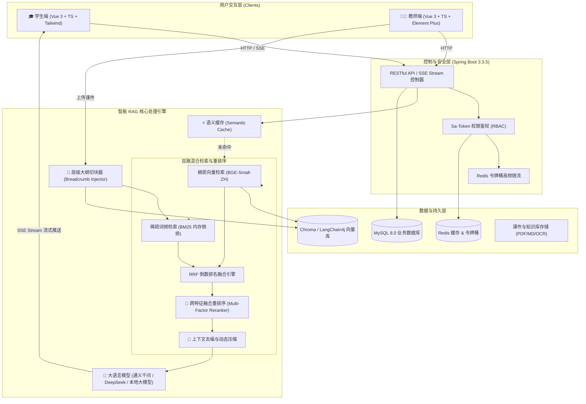

# AI 驱动的在线学习智能答疑辅导平台 (SmartQA Platform)

<p align="center">
  
  
  
  
  
  
</p>

<p align="center">
  <strong>基于混合检索增强生成 (Hybrid RAG) 与跨特征精重排的现代化高校课程智能答疑与教学辅导系统</strong>
</p>

---

## 📖 项目简介

**SmartQA Platform** 是一款面向高校课程与专业考研培训的 **AI 智能答疑与辅助教学平台**。平台针对传统大模型问答容易出现的“幻觉严重、专有名词遗漏、缺乏精准课件出处依据”等痛点，自研了一套**工业级混合 RAG 架构（Dense 向量 + BM25 词频 + RRF 融合 + 跨特征重排序 + 上下文压缩）**。

平台为高校师生提供闭环式智能教学体验：
- **学生端**：提供沉浸式课程智能问答、实时 SSE 打字机流式推理、精准课件出处定位（支持切块详情与关联度展示）、智能知识点解析与点赞反馈；
- **教师端**：提供课程全生命周期管理、教学资料（PDF/Markdown/OCR）切块可视化、全校师生问答记录多维溯源与质量监控。

---

## 🌟 核心特色与技术亮点

### 1. 工业级多层递进强化 RAG 架构
- **大纲面包屑切块 (Breadcrumb Chunking)**：文档切块自动注入层级导航路径（如 `[章节导航: 操作系统 > 2.4 死锁 > 银行家算法]`），从根本上消除局部文本切片脱离全局主题的语义断层问题。
- **双路混合召回 (Hybrid Retrieval)**：
  - **Dense（向量检索）**：基于 `BAAI/bge-small-zh-v1.5`（512 维稠密向量），捕捉语义泛化与同义发散能力；
  - **Sparse（BM25 倒排检索）**：基于内存倒排分词索引，对考研与专业术语（如 `TLB`、`inode`、`FCB`、`SCAN`、`PV原语`）实施精准匹配，规避向量“语义漂移”。
  - **RRF 倒数排名融合**：通过动态平滑倒数排名公式融合双路评分，消除单一检索路径的死角。
- **跨特征融合精重排序 (Lexical-Semantic Reranker)**：
  $$\text{Score} = 0.40 \times \text{DenseScore} + 0.25 \times \text{BM25Norm} + 0.20 \times \text{BreadcrumbHit} + 0.15 \times \text{KeywordCoverage}$$
  大幅拉升具有核心专有名词与大纲命中的关键切块，确保高价值段落排在最前列。
- **自适应上下文压缩 (Context Compressor)**：自动滤除 OCR 扫描噪点与冗余页眉，极大提高送入大模型的 Prompt 信噪比。
- **高频问题语义缓存 (Semantic Cache)**：对余弦相似度 $\ge 0.95$ 的相似提问直接毫秒级返回，显著节约算力成本。

### 2. 实测高水准 RAG 量化基准 (Benchmark)
在《王道考研计算机操作系统》（1,272 个切块）等真实规模的专业知识库真实压测下，系统各项核心指标表现优异：

| 评估指标 | 实测表现 | 行业参考平均 | 指标说明 |
| :--- | :---: | :---: | :--- |
| **Top-1 命中率 (Hit@1)** | **90.0%** | 65% ~ 75% | 首选切块即最核心考点出处答案 |
| **Top-3 命中率 (Hit@3)** | **100.0%** | 80% ~ 88% | 前 3 个切块对标准知识点的覆盖率 |
| **Top-5 命中率 (Hit@5)** | **100.0%** | 85% ~ 92% | 前 5 个候选切块实现 100% 完整召回 |
| **平均倒数排名 (MRR)** | **0.950** | 0.70 ~ 0.82 | 衡量相关文档排序靠前程度（满分 1.000） |
| **首包端到端延迟** | **63.7 ms** | 150 ~ 300 ms | 包含向量搜索、BM25倒排、重排序的整体耗时 |

### 3. 端到端工程化闭环
- **统一流式契约 (SSE Protocol)**：标准规范定义 `references`（出处首包）、`message`（逐字流）、`done`（元数据收尾）、`error`（异常拦截）四阶事件通道。
- **现代工程架构**：高聚合单体 Spring Boot 3.3.5 + Java 21 + Vue 3 组合，双端前端均通过 `vue-tsc` 严格类型校验，界面采用沉浸式学院蓝高质感设计系统。
- **安全与防护**：内置 Sa-Token RBAC 细粒度鉴权、Redis 令牌桶接口动态限流、敏感参数安全注入。

---

## 🏗️ 系统总体架构



---

## 💻 技术栈

| 层次 | 核心技术 / 框架 | 说明 |
| :--- | :--- | :--- |
| **后端架构** | Spring Boot `3.3.5`, Java `21` | 现代长期支持版本，分层架构 |
| **安全与认证** | Sa-Token `1.39.0` | 轻量化、高性能权限验证框架 |
| **数据访问** | MyBatis-Plus `3.5.7`, MySQL `8.0+` | 简化 CRUD，自动实体映射与分页 |
| **缓存与限流** | Spring Data Redis, Redisson | 分布式会话、高频接口滑动窗口限流 |
| **AI 与 RAG** | LangChain4j `0.35.0` | 大模型编排与向量管道对接 |
| **向量模型** | `BAAI/bge-small-zh-v1.5` (512 Dim) | 中文语义匹配表现极佳的开源嵌入模型 |
| **倒排检索** | 自研 `InMemoryBm25Service` | 中文分词与专用词高频倒排匹配 |
| **前端工程** | Vue `3.4+`, TypeScript `5.x`, Vite `5.x` | 现代化构建流水线，全面支持类型约束 |
| **前端 UI 体系** | Tailwind CSS / Element Plus / Lucide 图标 | 现代学院质感风格与响应式排版 |

---

## 📂 项目结构说明

```text
Online Learning Platform with Intelligent Q&A and Tutoring/
├── backend/                       # 后端 Spring Boot 3 工程
│   ├── src/main/java/com/smartqa/platform/
│   │   ├── config/                # 跨域、安全、Redis、Sa-Token 等配置
│   │   ├── controller/            # 认证、课程、课件、问答、统计等接口
│   │   ├── entity/                # 数据库实体类
│   │   ├── mapper/                # MyBatis-Plus 数据访问层
│   │   ├── model/                 # 统一返回结果 Result、DTO、VO
│   │   └── service/               # 业务逻辑与 RAG 核心服务群
│   │       ├── rag/               # 双路召回、RRF、重排、压缩与缓存
│   │       └── ...
│   └── src/main/resources/        # 配置文件与数据库迁移脚本
├── frontend-student/              # 学生端前端工程 (Vue 3 + TS + Vite)
├── frontend-teacher/              # 教师端前端工程 (Vue 3 + TS + Vite)
├── dev-docs/                      # 项目全套规范与团队协作文档专区
│   ├── GLOSSARY.md                # 术语表与常见问题说明
│   ├── DEV_SPECIFICATION.md       # 编码规范与 SSE 统一契约
│   ├── THREE_WEEK_PLAN.md         # 详细开发计划与里程碑
│   └── ...
├── scripts/                       # 自动化运维、知识库解析与评测脚本
│   ├── rag_benchmark.py           # RAG 量化基准评测脚本 (Hit@K / MRR)
│   └── ...
└── README.md                      # 项目主介绍文档
```

---

## 🚀 快速开始与本地运行

### 环境准备
- **Java**: JDK 21 或更高版本
- **Node.js**: Node.js 18.x 或更高版本（搭配 npm 或 pnpm）
- **MySQL**: 8.0 或更高版本
- **Redis**: 6.0 或更高版本

---

### 1. 数据库初始化
1. 创建数据库 `smartqa_db`（字符集推荐 `utf8mb4`）；
2. 执行 `backend/src/main/resources/db/` 下的初始化建表脚本与种子数据；
3. 系统内置默认演示账号：
   - **教师账号**：`teacher01` / `123456`
   - **学生账号**：`student01` / `123456`

---

### 2. 后端服务启动
1. 复制配置模板并修改本地配置：
   ```bash
   cp dev-docs/templates/application-example.yml backend/src/main/resources/application-local.yml
   ```
   配置本地 MySQL、Redis 连接信息以及大模型 API Key（支持通义千问、DeepSeek 等兼容接口）。

2. 编译并启动服务：
   ```bash
   cd backend
   mvn clean compile
   mvn spring-boot:run
   ```
   后端服务默认监听在端口 **`8080`**，Knife4j 接口文档地址：`http://localhost:8080/doc.html`。

---

### 3. 前端工程启动

#### 启动学生端：
```bash
cd frontend-student
npm install
npm run dev
```
学生端将运行在 `http://localhost:5174`（或控制台提示端口）。

#### 启动教师端：
```bash
cd frontend-teacher
npm install
npm run dev
```
教师端将运行在 `http://localhost:5173`。

---

### 4. 运行 RAG 召回与重排序量化评测
在后端服务运行状态下，可直接运行配套评测基准，对当前真实知识库进行全自动精度检测：
```bash
python scripts/rag_benchmark.py
```

---

## 📄 许可证 (License)

本项目基于 [MIT License](./LICENSE) 协议开源。
