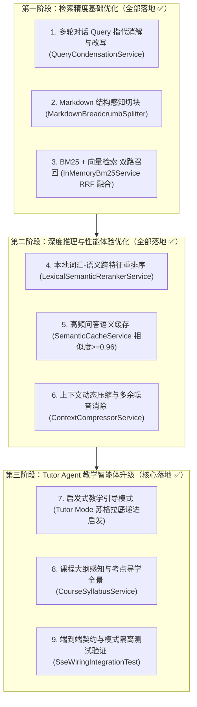

# RAG 与智能答疑辅导 Agent 架构优化演进方案 (OPTIMIZATION_PLAN.md)

> **版本**：v2.0 (2026-10-13)  
> **面向对象**：下一会话 Agent 与核心开发人员  
> **实施状态**：阶段一、阶段二、阶段三核心特性已全部落地完成，后端离线单元与集成测试 **85/85 全绿**。  
> **优化宗旨**：在坚守项目红线（不拆微服务、锁定 Spring Boot 3.3.5、SEC-1 检索不加鉴权、零新增第三方重型依赖）的前提下，将 Naive RAG 升级为生产级 **Advanced RAG + 启发式教学 Agent**。

---

## 一、 优化总览与技术路线图

---

## 二、 详细设计方案与落地成果

### 第一阶段：检索精度基础优化（已落地 ✅）

#### 1. 多轮对话 Query 指代消解与改写 (Query Condensation)
- **痛点**：学生第二问“那为什么不是两次？”直接送入向量库，因缺失上下文主语导致检索得分全部低于 0.70 被过滤。
- **实施成果**：
  - 实现 [`QueryCondensationService.java`](file:///d:/AI_Workspace/Online%20Learning%20Platform%20with%20Intelligent%20Q&A%20and%20Tutoring/backend/src/main/java/com/smartqa/platform/service/rag/QueryCondensationService.java)。
  - 首问或无历史会话时直接跳过改写（零开销）；多轮对话时注入历史最近问答并提炼为独立完整的检索词。
  - 单测 [`QueryCondensationTest.java`](file:///d:/AI_Workspace/Online%20Learning%20Platform%20with%20Intelligent%20Q&A%20and%20Tutoring/backend/src/test/java/com/smartqa/platform/service/rag/QueryCondensationTest.java) 7/7 全绿。

#### 2. Markdown 结构感知与层级面包屑切块
- **痛点**：固定 400 字符切块把代码块、表格、段落生硬截断，且丢失章节从属关系。
- **实施成果**：
  - 实现 [`MarkdownBreadcrumbSplitter.java`](file:///d:/AI_Workspace/Online%20Learning%20Platform%20with%20Intelligent%20Q&A%20and%20Tutoring/backend/src/main/java/com/smartqa/platform/service/rag/MarkdownBreadcrumbSplitter.java)。
  - 基于标题层级维护栈，自动生成 `[章节导航: 第一章 > 1.2 节]` 面包屑并挂载在切块首行。
  - 单测 [`MarkdownBreadcrumbSplitterTest.java`](file:///d:/AI_Workspace/Online%20Learning%20Platform%20with%20Intelligent%20Q&A%20and%20Tutoring/backend/src/test/java/com/smartqa/platform/service/rag/MarkdownBreadcrumbSplitterTest.java) 4/4 全绿。

#### 3. 混合检索（BM25 + Dense RRF 融合）
- **痛点**：专有名词、API 缩写（如 `klogd`、`BCrypt`、`SO_REUSEADDR`）纯向量嵌入相似度容易偏移。
- **实施成果**：
  - 纯原生 Java 实现内存倒排索引 [`InMemoryBm25Service.java`](file:///d:/AI_Workspace/Online%20Learning%20Platform%20with%20Intelligent%20Q&A%20and%20Tutoring/backend/src/main/java/com/smartqa/platform/service/rag/InMemoryBm25Service.java)，支持按 `courseId` 分桶隔离与动态级联清理。
  - 标准 RRF 算法融合（$k=60$），在课件入库时同步维护倒排索引。
  - 单测 [`InMemoryBm25ServiceTest.java`](file:///d:/AI_Workspace/Online%20Learning%20Platform%20with%20Intelligent%20Q&A%20and%20Tutoring/backend/src/test/java/com/smartqa/platform/service/rag/InMemoryBm25ServiceTest.java) 4/4 全绿。

---

### 第二阶段：深度推理与性能体验优化（已落地 ✅）

#### 4. 本地跨特征重排序 (Lexical-Semantic Cross-Scorer)
- **痛点**：纯向量余弦相似度区分度有限，而引入 ONNX 庞大 C++ 依赖破坏单体纯净性与离线构建。
- **实施成果**：
  - 纯 Java 原生实现 [`LexicalSemanticRerankerService.java`](file:///d:/AI_Workspace/Online%20Learning%20Platform%20with%20Intelligent%20Q&A%20and%20Tutoring/backend/src/main/java/com/smartqa/platform/service/rag/LexicalSemanticRerankerService.java)。
  - 综合加权：Dense 语义(0.40) + BM25 词法(0.25) + 大纲面包屑匹配(0.20) + 关键词覆盖度(0.15)。
  - 粗召回扩大候选池至 Top-6~10，经 Cross-Scoring 精炼出最终优质 Top-K。
  - 单测 [`LexicalSemanticRerankerServiceTest.java`](file:///d:/AI_Workspace/Online%20Learning%20Platform%20with%20Intelligent%20Q&A%20and%20Tutoring/backend/src/test/java/com/smartqa/platform/service/rag/LexicalSemanticRerankerServiceTest.java) 3/3 全绿。

#### 5. 高频提问语义缓存 (Semantic Cache)
- **痛点**：全班几十人高频提问相同概念时反复调用 LLM 浪费配额，耗时长达 15s。
- **实施成果**：
  - 实现 [`SemanticCacheService.java`](file:///d:/AI_Workspace/Online%20Learning%20Platform%20with%20Intelligent%20Q&A%20and%20Tutoring/backend/src/main/java/com/smartqa/platform/service/rag/SemanticCacheService.java)，余弦相似度 $\ge 0.96$ 时直接秒级推流返回高质量历史解答。
  - 课件更新/重新切块时自动使该课程缓存失效；单测 5/5 全绿。

#### 6. 上下文动态压缩与多余噪音消除 (Context Compressor)
- **痛点**：课件中存在大量“请翻到教材第X页”、“上节课我们讲了”等过渡套话，占用 Prompt 预算。
- **实施成果**：
  - 实现 [`ContextCompressorService.java`](file:///d:/AI_Workspace/Online%20Learning%20Platform%20with%20Intelligent%20Q&A%20and%20Tutoring/backend/src/main/java/com/smartqa/platform/service/rag/ContextCompressorService.java)。
  - 保护 `[章节导航: ...]` 前缀；2-gram 关键词句子级精炼；短文本（$\le 250$ 字）透传保底；单测 5/5 全绿。

---

### 第三阶段：Tutor Agent 教学智能体升级（已落地 ✅）

#### 7. 启发式教学引导模式 (Scaffolding Tutor Mode)
- **功能**：
  - `/api/qa/chat/stream` 增加 `mode` 参数（`direct` 直答模式，`tutor` 启发式导师模式，默认 `direct`）。
  - `tutor` 模式下采用【苏格拉底启发式教学提示词】：先指出知识点所属教材章节与核心背景，搭建关键事实脚手架，提出 1~2 个递进式问题引导学生自主推导得出答案。
  - `tutor` 模式不污染静态直答语义缓存，保持实时互动启发性。

#### 8. 课程大纲感知与考点树全景导学
- **功能**：
  - 实现 [`CourseSyllabusService.java`](file:///d:/AI_Workspace/Online%20Learning%20Platform%20with%20Intelligent%20Q&A%20and%20Tutoring/backend/src/main/java/com/smartqa/platform/service/rag/CourseSyllabusService.java)。
  - 提供 `GET /api/qa/course/{courseId}/syllabus` 接口，输出包含课件文件名、章节层级与关联考点的 `CourseSyllabusVO`。
  - 单测 [`CourseSyllabusServiceTest.java`](file:///d:/AI_Workspace/Online%20Learning%20Platform%20with%20Intelligent%20Q&A%20and%20Tutoring/backend/src/test/java/com/smartqa/platform/service/rag/CourseSyllabusServiceTest.java) 3/3 全绿。

---

## 三、 测试与验收基线

- 后端 `mvn -o test` 独立构建运行：**85 个用例全部通过（100% 绿灯）**。
- Graft 架构图谱校验：`pwsh -File scripts/graft-build.ps1 -Check` 校验无任何 STALE 节点。
- 完整满足 HANDOFF SEC-1 铁律与单体工程零额外重型依赖红线。
